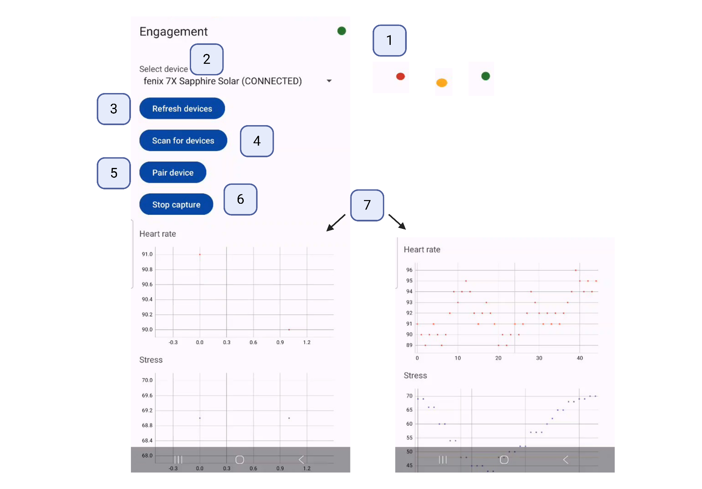

# Engagement

An Android app that streams live biometric data from a Garmin wearable to a computer via [Lab Streaming Layer (LSL)](https://labstreaminglayer.org/) using PyLSL. Built for research use. First described in: Garmin Wearables for Real-time Cognitive State Assessment in Game play via Engagement and Lab Streaming Layer

> **PyLSL setup guidance is available upon request** — contact info below.

---

## Table of Contents

1. [Prerequisites](#1-prerequisites)
2. [Installing the App (Sideloading)](#2-installing-the-app-sideloading)
3. [Understanding the Interface](#3-understanding-the-interface)
4. [First Launch — Permissions](#4-first-launch--permissions)
5. [Pairing Your Garmin Device](#5-pairing-your-garmin-device)
6. [Live Charts](#6-live-charts)
7. [Status Indicator](#7-status-indicator)
8. [Stopping and Disconnecting](#8-stopping-and-disconnecting)
9. [Sharing the Debug Log](#9-sharing-the-debug-log)
10. [Estimated Data Frequencies](#10-estimated-data-frequencies)
11. [Demo and Contact](#11-demo-and-contact)

---

## 1. Prerequisites

Before using the app you need:

- **Android device** running Android 9.0 or later with Bluetooth support
- **Garmin wearable** compatible with the Garmin Health Companion SDK (e.g., Fenix series)
- **Wi-Fi network** shared between your Android phone and the computer receiving LSL streams
- The Engagement APK (download from [Releases](../../releases/latest))

> The app does **not** require Garmin Connect Mobile, but the Garmin device must not be actively connected to another app while pairing.

---

## 2. Installing the App (Sideloading)

1. Download the latest `Engagement.apk` from the [Releases](../../releases/latest) page.
2. Transfer the APK to your Android device (via USB, email, or file transfer).
3. On the device go to **Settings → Apps → Special app access → Install unknown apps** and allow installation from the source you used to transfer the file.
4. Open the APK and follow the on-screen prompts to install.

---

## 3. Understanding the Interface

  

| Element | Description |
|---|---|
| **Status dot [1]** | Color-coded system health indicator — see [Status Indicator](#7-status-indicator) |
| **Device Selector [2]** | Dropdown of all paired Garmin devices; select one to view its charts |
| **Refresh devices [3]** | Refreshes the device list |
| **Scan [4]** | Initiates a 15-second Bluetooth scan for nearby Garmin devices |
| **Pair [5]** | Opens a picker from scan results to initiate pairing |
| **Stop capture [6]** | Menu to stop all capture or unpair a specific device |
| **Charts [7]** | One scatter chart per metric; auto-updates as data arrives |

---

## 4. First Launch — Permissions

On first launch the app requests Bluetooth permissions:

- **Android 12 and later:** `Bluetooth Scan` and `Bluetooth Connect`
- **Android 9–11:** `Location (Fine)`

Tap **Allow** for all requested permissions. Without these, the app cannot discover or communicate with your Garmin device.

If you previously denied a permission, go to **Settings → Apps → Engagement → Permissions** and grant the required permissions manually.

---

## 5. Pairing Your Garmin Device

### Step 1 — Scan for devices

1. Open the app. The main screen displays the **Garmin Tracking** view.
2. Tap the **Scan** button. The app searches for nearby Garmin devices over Bluetooth for up to 15 seconds.
3. Discovered devices appear in the scanned device list.

### Step 2 — Pair

1. Tap the **Pair** button.
2. Select your device from the list of scanned Garmin devices.
3. On success the device appears in the **Device selector** dropdown and streaming starts automatically.

### Already-paired devices

If the device was previously paired it appears in the dropdown immediately on launch. If not already selected, choose it from the dropdown to make it the active device.

---

## 6. Live Charts

Each metric has its own scatter chart that updates in real time:

| Chart | Color | Notes |
|---|---|---|
| Heart Rate | Red | Beats per minute |
| Stress | Purple | Garmin stress score (0–100) |
| HRV | Dark red | Beat-to-beat interval in ms |
| SpO2 | Brown | Blood oxygen percentage |
| Respiration | Green | Breaths per minute |

**Chart interactions:**
- **Pinch** to zoom in or out
- **Drag** to pan along the time axis

Charts are per-device; switching devices in the dropdown updates all charts to that device's data history.

---

## 7. Status Indicator

The colored dot in the top-right corner of the toolbar shows overall system state at a glance:

| Color | Meaning |
|---|---|
| 🟢 Green | Streams working — device connected, LSL streaming |
| 🟡 Yellow | Transitional — device connecting or LSL initializing |
| 🔴 Red | Error — SDK not initialized, device disconnected, or LSL failure |

> **Long-press the status dot** to share the debug log file — see [Sharing the Debug Log](#9-sharing-the-debug-log).

---

## 8. Stopping and Disconnecting

Tap the **Stop capture [6]** button to access two options:

### Stop All Capture

Halts real-time data collection and closes all LSL outlets for the current session. The app shows a **"Restart required"** message. Fully close and reopen the app to resume.

> ⚠️ **Required to stop streaming.** If the app is left open and running, unnecessary battery drain will occur.

### Unpair Device

Removes the selected device from the paired devices list. The device will need to be scanned and paired again before streaming can resume.

---

## 9. Sharing the Debug Log

The app writes a timestamped log to internal storage (`en_debug.txt`) during every session. This log records:

- LSL outlet creation and status updates
- Device connection state changes
- Any initialization errors

To share the log:

1. **Long-press** the status dot **[1]**.
2. Choose your preferred sharing method and send the file.

---

## 10. Estimated Data Frequencies

Recorded during a 45-minute continuous sedentary session:

| Stream | Unit | Est. Rate | Mean Interval | Median Interval | Samples (45 min) |
|---|---|---|---|---|---|
| `Garmin_HRV` | ms | ~1.15 Hz | 0.87 s | 0.76 s | 12,732 |
| `Garmin_SpO2` | % | ~0.91 Hz | 1.10 s | 1.01 s | 10,065 |
| `Garmin_HeartRate` | BPM | ~0.49 Hz | 2.06 s | 1.21 s | 5,380 |
| `Garmin_Stress` | 0–100 | ~0.29 Hz | 3.39 s | 3.08 s | 3,236 |
| `Garmin_Respiration` | breaths/min | ~0.08 Hz | 12.97 s | 10.05 s | 823 |

---

## 11. Demo and Contact

A demonstration video is available on YouTube ((https://youtube.com/shorts/03es3QKW4cc?feature=share)).

For questions, contact the lead developer:

**Amelia Whorton**
Wright State University
📧 [whorton.10@wright.edu](mailto:whorton.10@wright.edu)
